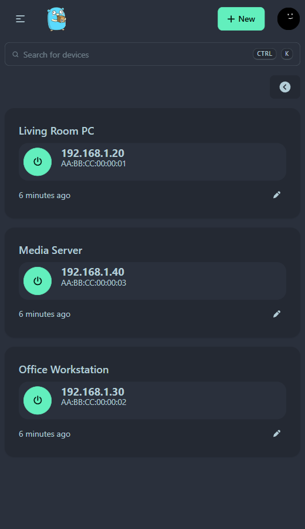

# UpSnapTray

An unofficial Windows system-tray client for [UpSnap](https://github.com/seriousm4x/UpSnap) — click the tray icon and a compact panel opens with your UpSnap dashboard, no browser tab required.




## Features

- Tray icon with a click-to-toggle flyout panel (WebView2), anchored to the bottom-right corner
- Panel hides automatically when it loses focus (like a native flyout); `Esc` also hides it
- Persistent login: the WebView2 user-data folder keeps your UpSnap session
- Auto-start on login (enabled by default on first run, toggleable)
- English / 中文 UI — follows the Windows display language, switchable from the tray menu (persisted as `lang` in `settings.json`)
- Theme-aware tray icon: separate light/dark variants (16–256 px ICO), picked from the Windows app theme
- Right-click menu: open panel / open in browser / reload / auto-start / language / exit
- Single instance, tiny footprint, no installer

## Requirements

- Windows 10/11 (x64)
- [.NET 10 Desktop Runtime](https://dotnet.microsoft.com/download) (framework-dependent build)
- [WebView2 Runtime](https://developer.microsoft.com/microsoft-edge/webview2/) (preinstalled on Windows 11; on Windows 10 usually present via Edge)
- A reachable UpSnap instance

## Build

```powershell
dotnet publish src/UpSnapTray.csproj -c Release -r win-x64 --self-contained false -o dist
```

If your machine has no NuGet package sources configured, pass one explicitly:

```powershell
dotnet publish src/UpSnapTray.csproj -c Release -r win-x64 --self-contained false --source "https://api.nuget.org/v3/index.json" -o dist
```

Run `dist\UpSnapTray.exe`.

## Configuration

Create `%APPDATA%\UpSnapTray\settings.json`:

```json
{
  "url": "http://192.168.1.10:8090",
  "lang": "en"
}
```

`url` is the only required key (`lang` is optional: `en` or `zh`). When `lang` is absent the UI follows the Windows display language; picking a language in the tray menu writes it back here.

Default when the file is absent: `http://localhost:8090`.

## Behaviour

| Action | Result |
|---|---|
| Left-click tray icon | Show / hide the panel |
| Panel loses focus | Panel hides |
| `Esc` | Hide the panel |
| Right-click tray icon | Context menu |

First run writes the auto-start entry under `HKCU\Software\Microsoft\Windows\CurrentVersion\Run` (value `UpSnapTray`). Uncheck “开机启动” in the menu to remove it.

## Diagnostics

Log: `%LOCALAPPDATA%\UpSnapTray\log.txt`

Run with `--selftest` to open the panel for 12 seconds and log the WebView2 navigation result:

```powershell
UpSnapTray.exe --selftest
```

## Uninstall

1. Right-click the tray icon → 退出 (exit)
2. Delete the `UpSnapTray` value under `HKCU\Software\Microsoft\Windows\CurrentVersion\Run`
3. Delete the app folder, `%LOCALAPPDATA%\UpSnapTray` and `%APPDATA%\UpSnapTray`

## Disclaimer

This is an independent, unofficial companion client. It only talks to UpSnap's HTTP interface; it is not affiliated with or endorsed by the UpSnap project. UpSnap itself is MIT-licensed and available at [seriousm4x/UpSnap](https://github.com/seriousm4x/UpSnap).

## License

MIT — see [LICENSE](LICENSE).
